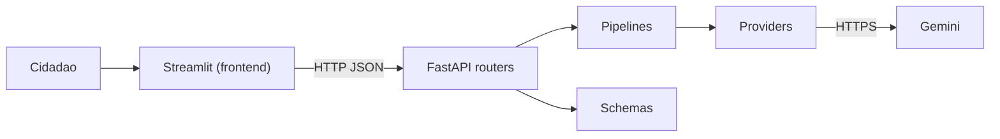

# Orienta Saúde

Prova de Conceito CitizenTech da Global Solution 2026/2 (Front-end em Sistemas de IA). O cidadão descreve o que está sentindo e recebe, em linguagem simples, a urgência do caso e o serviço de saúde mais adequado (cuidado em casa, UBS, UPA ou SAMU).

## Problema e público

PREENCHER: quem é afetado, qual a dor concreta e a fonte que sustenta (dado, notícia, relato ou entrevista). Sugestão: superlotação de UPAs e pronto-socorros por casos de baixa complexidade, e dificuldade do cidadão em saber onde buscar atendimento.

## Mapa de UPAs próximas

Aba "UPAs próximas": o cidadão informa só o CEP e vê as UPAs mais próximas em lista e em mapa Plotly (OpenStreetMap, com hover e zoom).

Fontes de dados abertos cruzadas com a entrada do cidadão:

- **ViaCEP:** CEP para endereço e código IBGE do município.
- **Nominatim (OpenStreetMap):** endereço para latitude e longitude.
- **AwesomeAPI:** coordenadas do CEP de cada unidade, usadas para conferir o cadastro do CNES.
- **CNES (DataSUS):** UPAs e pronto atendimentos do município, com coordenadas, telefone e turno. O backend pagina a API (20 por página), ignora cadastros sem coordenada ou desabilitados, guarda o resultado por 6 horas e calcula a distância (fórmula de haversine).

Privacidade: só o CEP é enviado, ele não é gravado e o cache do front guarda a consulta por 10 minutos. Qualidade da posição: as coordenadas do CNES às vezes erram. O backend cruza cada unidade com a posição do CEP dela (AwesomeAPI); se divergirem mais de 1,5 km, tenta corrigir pelo nome no OpenStreetMap (Nominatim) e reordena a lista. Se não conseguir corrigir, a unidade aparece marcada como "posição aproximada" no mapa e na lista. O botão "Como chegar" usa nome e endereço escritos, não coordenadas.

Limites conhecidos: o CNES pode ter telefone e horário desatualizados, e a busca cobre apenas o município do CEP.

## Fluxo CitizenTech

1. **Entrada:** formulário com validação (texto de 10 a 800 caracteres, faixa de idade, duração, sinais de alerta, confirmação de ciência).
2. **Processamento inteligente:** o front chama a API FastAPI, que chama o Gemini com saída estruturada (JSON Schema + modelo Pydantic). O front nunca fala com o provedor de IA.
3. **Resposta:** badge de urgência (cor + ícone + texto), serviço recomendado, ações práticas, sinais de alerta e protocolo.
4. **Human-in-the-loop:** o cidadão confirma ou corrige a urgência e avalia se foi útil. Só então a solicitação é considerada revisada.

Trava de segurança no pipeline: qualquer sinal de alerta grave marcado (dor no peito, falta de ar, desmaio, sangramento, confusão, sinais de AVC) eleva o resultado para emergência com SAMU, mesmo que a IA diga o contrário.

## Arquitetura



```
backend/
  app/
    routers/     um arquivo por serviço (health, meta, triage, review, units)
    schemas/     modelos Pydantic de entrada e saída
    pipelines/   lógica de triagem, trava de segurança, revisão
    providers/   acesso ao Gemini e armazenamento em memória
  tests/         pytest, sem subir interface nem chamar a IA
frontend/
  features/      telas por responsabilidade
  ui/            tema e componentes reutilizáveis
  state/         estado da sessão e dados derivados
  providers/     cliente HTTP da API
```

## Como rodar

Copie `.env.example` para `.env` na raiz e preencha `GEMINIAPIKEY`.

### Local

```bash
cd backend
pip install -r requirements.txt
uvicorn app.main:aplicacao --port 8000
```

```bash
cd frontend
pip install -r requirements.txt
streamlit run app.py
```

### Docker

```bash
docker compose up --build
```

Front em `http://localhost:8501`, API em `http://localhost:8000/docs`.

### Testes

```bash
cd backend
pytest
```

## Deploy

PREENCHER: link do deploy (por exemplo front no Streamlit Community Cloud e API no Render). No front, defina a variável `APIURL` com a URL pública da API. Na API, defina `ALLOWEDORIGINS` com a URL do front (sem `*`).

## Acessibilidade aplicada

- Urgência sempre comunicada por cor, ícone e texto.
- Contraste alto entre texto e fundo nos badges, cartões e gráficos.
- Todos os campos com rótulo claro e textos de ajuda.
- Foco de teclado visível em botões, campos e abas.
- Linguagem simples, sem termos técnicos.
- Mensagens de erro em português, sem detalhes técnicos.
- Gráficos com cores e rótulos textuais nos eixos.

## ODS

- **ODS 3 – Saúde e Bem-Estar:** PREENCHER justificativa.
- **ODS 10 – Redução das Desigualdades:** PREENCHER justificativa.

## Decisões técnicas

- **Streamlit:** abas, colunas e sidebar nativos, Plotly integrado, `session_state` e cache.
- **Gemini com JSON Schema:** garante campos previsíveis; a resposta ainda é revalidada com Pydantic.
- **Prompt:** proíbe diagnóstico e receitas, trata o relato como dado e, na dúvida, escolhe a urgência maior.
- **Estado e cache:** `session_state` guarda histórico e resultado atual (sem repetir chamada ao LLM a cada rerun); `cache_data` guarda as opções do formulário; `cache_resource` guarda o cliente HTTP.
- **Segredos:** chave só em variável de ambiente; `.env` fora do Git.
- **Privacidade:** o formulário não pede nome, CPF nem endereço.

## Ética e limites da IA

- Riscos: erro de classificação, viés, alucinação, uso como substituto de consulta.
- Não faz diagnóstico, não indica remédios, não substitui profissional de saúde.
- Mitigações: trava de sinais graves, aviso fixo, revisão humana obrigatória antes de considerar a solicitação concluída.
- PREENCHER: demais limites observados nos testes.

## Evidências de validação

### Teste com pessoas do público-alvo

PREENCHER: mínimo de 3 pessoas, roteiro curto, observações e um ajuste feito a partir do feedback.

| Pessoa | Perfil | Tarefa | Observação | Ajuste feito |
|---|---|---|---|---|
| | | | | |

### Casos de teste da IA

PREENCHER com resultados reais obtidos (mínimo de 3 casos).

| Entrada | Saída esperada | Saída obtida | Ajuste realizado |
|---|---|---|---|
| | | | |
